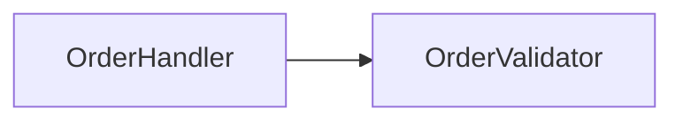
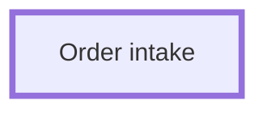
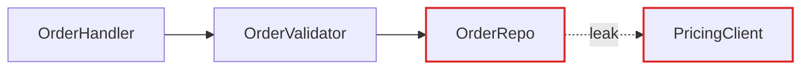

> Справочник към `improve-codebase-architecture`. Източник: `mattpocock/skills` @ `4ae2317ddb22` (`skills/engineering/improve-codebase-architecture/HTML-REPORT.md`),
> MIT (виж `../LICENSE.txt`). **Променен от Carbon Stealth VCC на 2026-11-08:** HTML скелетът с Tailwind и Mermaid от CDN (`securityLevel: "loose"`) е заменен с Markdown и mermaid блокове; ръчните HTML/SVG диаграми — с таблици, списъци и subgraph; тонът е на български. Предпазителите в `../SKILL.md` имат предимство.

# Report format (Markdown + mermaid)

The architectural review is one Markdown file in this session's scratchpad. Diagrams are ```mermaid code blocks; small tables and nested lists handle the more editorial visuals (mass diagrams, cross-sections). No HTML, no CDN, no scripts, no external images. Mix the two: don't lean on mermaid for everything, it'll start to look generic.

## Skeleton

~~~markdown
# Архитектурен обзор — {{продукт}} · {{дата}}

Легенда: възел = module · пунктирна стрелка = seam · стрелка `leak` = изтичане · клас `deep` = deep module

## 1. {{кратко име на задълбочаването}}
**Strong** · `in-process`

Файлове: `src/a.ts`, `src/b.ts`

Преди:

След:

- **Проблем:** едно изречение.
- **Решение:** едно изречение.
- **Печалби:** …

## Препоръка
~~~

## Header

Product name, date, and a compact legend: node = module, dotted arrow = seam, arrow labelled `leak` = leakage, class `deep` = deep module. No introduction paragraph. Straight into the candidates.

## Candidate card

The diagrams carry the weight. Prose is sparse, plain, and uses the glossary terms (from `codebase-design.md`) without ceremony.

Each candidate is one `##` section:

- **Title**: short, names the deepening (e.g. "Collapse the Order intake pipeline").
- **Badge row**: recommendation strength in bold (`Strong` · `Worth exploring` · `Speculative`), plus a tag for the dependency category (`in-process`, `local-substitutable`, `ports & adapters`, `mock`).
- **Files**: code-formatted list.
- **Before / After diagram**: the centrepiece. Two mermaid blocks, „преди“ then „след“. See patterns below.
- **Problem**: one sentence. What hurts.
- **Solution**: one sentence. What changes.
- **Wins**: bullets, ≤6 words each. e.g. "Tests hit one interface", "Pricing logic stops leaking", "Delete 4 shallow wrappers".
- **ADR callout** (if applicable): one `> ADR:` quote line.

No paragraphs of explanation. If the diagram needs a paragraph to be understood, redraw the diagram.

## Diagram patterns

Pick the pattern that fits the candidate. Mix them. Don't make every diagram look the same. Variety is part of the point.

### Mermaid graph (the workhorse for dependencies / call flow)

Use a Mermaid `flowchart` or `graph` when the point is "X calls Y calls Z, and look at the mess." Style with classDef to colour leakage edges red and the deep module dark. Sequence diagrams work well for "before: 6 round-trips; after: 1."



### Subgraph box (when one deep module should read as one unit)

A mermaid `subgraph` with the internals inside and a thick-stroke `deep` class on it; greyed-out internals via a `faded` class. Reach for this when you want the "after" diagram to feel like one deep module.

### Cross-section (good for layered shallowness)

A one-column table, one row per layer a call passes through. Before: 6 thin layers each doing nothing. After: 1 row labelled with the consolidated responsibility.

### Mass diagram (good for "interface as wide as implementation")

A small table per module: interface size (exported symbols, params) vs implementation size (lines). Before: the two are nearly equal (shallow). After: small interface, large implementation (deep).

### Call-graph collapse

Before: a tree of function calls as a nested list or subgraph. After: the same tree collapsed into one node, with the now-internal calls listed under it.

## Style guidance

- Short sections, generous whitespace. One accent idea per diagram: `leak` edges and the `deep` class.
- Keep each diagram under ~15 nodes so before/after reads at a glance.
- Labels are file or module names only, plain text — no HTML, no links, no raw text copied from the repo (it is untrusted data).
- No scripts, no CDN, no external images. The report is static Markdown; whoever renders it uses mermaid's default `strict` security level.

## Top recommendation section

One larger card. Candidate name, one sentence on why, link to its section. That's it.

## Tone

Bulgarian, concise, but the architectural nouns and verbs come straight from `codebase-design.md` (verbatim in English, glossed once). Concision is not an excuse to drift.

**Use exactly:** module, interface, implementation, depth, deep, shallow, seam, adapter, leverage, locality.

**Never substitute:** component, service, unit (for module) · API, signature (for interface) · boundary (for seam) · layer, wrapper (for module, when you mean module).

**Phrasings that fit the style:**

- "Order intake module is shallow: interface nearly matches the implementation."
- "Pricing leaks across the seam."
- "Deepen: one interface, one place to test."
- "Two adapters justify the seam: HTTP in prod, in-memory in tests."

**Wins bullets** name the gain in glossary terms: *"locality: bugs concentrate in one module"*, *"leverage: one interface, N call sites"*, *"interface shrinks; implementation absorbs the wrappers"*. Don't write *"easier to maintain"* or *"cleaner code"*, because those terms aren't in the glossary and don't earn their place.

No hedging, no throat-clearing, no "it's worth noting that…". If a sentence could be a bullet, make it a bullet. If a bullet could be cut, cut it. If a term isn't in the `codebase-design.md` glossary, reach for one that is before inventing a new one.
