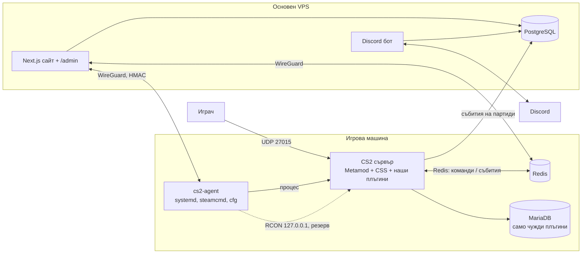

# Проучване: CS2 сървър „CarbonStealth.eu | Dust2 DM“ — от нулата до пускане

_Дата: 2026-10-24 · Метод: пет паралелни проучвания (експлоатация на сървъра, модинг рамки и
плъгини, Discord и VIP, правила на Valve и право на ЕС, пазар и конкуренти) срещу първоизточници —
файловете на самата игра (огледалото SteamDB GameTracking), GitHub репа и тагове, Steam/Valve,
Hetzner, docs.discord.com, EUR-Lex. Ключовите твърдения са проверени повторно на ръка (версии,
цени, cfg стойности, API отговори). Маркери: ✅ = потвърдено срещу първоизточник; ⚠️ = вторичен,
единичен или непотвърден източник. Правните изводи не са правен съвет._

**Текуща версия на играта към днес:** `PatchVersion=1.41.9.2`, `VersionDate=Oct 22 2026` ✅
([steam.inf](https://github.com/SteamDatabase/GameTracking-CS2/blob/master/game/csgo/steam.inf)).

---

## 0. Резюме в 12 точки

1. **Технически е напълно постижимо** с вградения DM режим на CS2 + рамката CounterStrikeSharp
   (C#) + наши плъгини. Сървърът е същото Steam приложение `730`, сваля се анонимно през SteamCMD ✅.
2. **Червена линия №1 — скинове.** Плъгини за скинове/ножове/ръкавици/агенти, които играчът не
   притежава (WeaponPaints, `!ws`, `!knife`), и фалшиви рангове водят до **перманентен бан на GSLT
   и matchmaking cooldown за оператора**, без обжалване ✅
   ([Steam Support](https://help.steampowered.com/en/faqs/view/07AF-502E-A104-BD4B)). Конкурентите
   ги пускат открито — ние **не**. Отличаваме се с прогресия, честна игра и общност.
3. **Отделна машина за играта**, не уеб VPS-ът с 15-те продукта: DDoS по игровото IP сваля и
   сайтовете, CPU jitter разваля tick-а, а чужд native код не бива да стои до medqr (Art. 9 данни).
   Препоръка: dedicated root **Hetzner AX42 — 99 €/мес. + 49 € setup** ✅, минимум CCX13 (42,99 €/мес.
   след поскъпването от 15.06.2026) ✅.
4. **Рамка:** Metamod:Source 2.0 (dev) + **CounterStrikeSharp v1.0.378** (2026-10-23, `net10.0`) ✅.
   Най-голямата жива екосистема; поправки след ъпдейт на CS2 обикновено до ~1 ден ✅.
5. **Наготово:** NockyCZ/CS2-Deathmatch (MIT — режими, ротация, оръжия, спаунове за de_dust2) и
   CS2-SimpleAdmin (банове, мютове, меню в играта) ✅. **Пишем сами:** рангове/сезони, мисии,
   weapon mastery, баунти, немезис, VIP, Discord мост, доклади, демо качване, heatmap-и.
6. **Бази:** екосистемата е почти изцяло **MySQL/MariaDB** ✅ — държим изолирана MariaDB само за
   чуждите плъгини; всичко наше е на **PostgreSQL** (Npgsql в C#, Prisma в уеба).
7. **Ъпдейти:** ~5 на месец (64 версии за последните 12 месеца) ✅; стар сървър **изпада от
   листинга** ✅. Нужен е автоматичен pipeline с резервен „ванилов“ старт.
8. **Пълен контрол от сайта** = наш C# плъгин-мост (Redis) за действията в играта + малък агент на
   машината за процеса (старт/стоп/ъпдейт). **RCON само като локален резерв** — в CS2 няма защита
   срещу brute-force и няма нативни банове ✅.
9. **Discord:** VIP през **Discord Premium Apps** (user subscription SKU) — достъпно за екипи в ЕС ✅;
   Server Subscriptions вероятно **не** са налични за България ⚠️. Свързване Steam ↔ Discord през
   Steam OpenID на нашия сайт + Linked Roles ✅.
10. **VIP = само козметика и удобство.** Никакъв pay-to-win (AWP само за VIP, по-бърз респаун,
    изритване на безплатни играчи) — това е основното оплакване от конкурентите ⚠️.
11. **Пазарът:** Dust2 DM е по-тясна ниша от Mirage (10 от топ 15 DM сървъра са Mirage, 4 — Dust2) ✅;
    български DM сървър практически няма ✅. Конкурентите разпиляват играчи по десетки полупразни
    сървъри — ние държим **един пълен** сървър.
12. **Право:** политика за поверителност по чл. 13 GDPR (вкл. изискванията на Steam API), срокове
    за IP/чат/демота, DSA обосновка при бан, банер за бисквитки, общи условия за VIP с 14 дни отказ
    (услуга, не съдържание), VIP 18+ или с родителско съгласие.

---

## 1. Изискванията → решението

| Искане | Решение | Раздел |
|---|---|---|
| Наш VPS | Отделна dedicated машина в Hetzner (Германия), панелът остава на основния VPS | §2 |
| Само Dust2, Deathmatch | `game_type 1` + `game_mode 2`, mapgroup `mg_de_dust2`, FFA | §3 |
| Име „CarbonStealth.eu \| Dust2 DM“ | `hostname` само в `server.cfg` (в shell `\|` е pipe) | §3 |
| Custom плъгини | CounterStrikeSharp (C#, .NET 10), наши плъгини на PostgreSQL | §5–7 |
| Иновативни, зарибяващи плъгини | Сезони, weapon mastery, мисии, баунти, немезис, heatmap-и, Discord роли | §7 |
| Админ панел в играта | CS2-SimpleAdmin меню `css_admin` + нашите групи/флагове | §8 |
| Админ панел на сайта, пълен контрол | Next.js панел → плъгин-мост (Redis) + агент на машината (WireGuard) | §9 |
| Discord с VIP/custom роли | Discord бот + Premium Apps + Linked Roles, perks в играта | §10–11 |

---

## 2. Хардуер и хостинг

### 2.1 Изисквания на сървъра

- Диск: **най-малко 60 GB** за играта ✅ ([joedwards32/CS2](https://github.com/joedwards32/CS2)) + място за
  модове, логове и демота. Hetzner препоръчва 80 GB ⚠️
  ([Hetzner tutorial](https://community.hetzner.com/tutorials/game-server-cs2/)).
- Минимум 2 CPU / 2 GiB RAM ✅ (README на образа, не официално от Valve — Valve не публикува числа ⚠️).
- Сървърът зависи основно от **едно бързо ядро**; тактовата честота е по-важна от броя ядра ⚠️.
- Стартира се **винаги през `game/cs2.sh`** — той задава `LD_LIBRARY_PATH`; по коментара в него
  dedicated сървърът върви на „any reasonably up to date glibc distribution“ → Ubuntu 24.04 е ОК ✅
  ([cs2.sh](https://github.com/SteamDatabase/GameTracking-CS2/blob/master/game/cs2.sh)).

### 2.2 Защо не на сегашния VPS

| Риск | Последица |
|---|---|
| DDoS по игровото IP | падат и 15-те сайта на същото IP |
| CPU jitter от уеб/билд натоварване | скокове във frametime-а → „лаг“ за всички играчи |
| Native код на трети страни (C++/C#) | на един хост с medqr (здравни данни, Art. 9) и плащания |
| 60+ GB диск, ~5 ъпдейта/мес. | запълване и I/O пикове |

Ако все пак споделяме временно: systemd `AllowedCPUs=` (cpuset, cgroup v2) + `CPUWeight=` за CS2 и
`--cpuset-cpus` за уеб контейнерите на останалите ядра ✅
([systemd.resource-control](https://www.freedesktop.org/software/systemd/man/latest/systemd.resource-control.html)).

### 2.3 Варианти и цени (без ДДС)

Hetzner коригира цените на **15.06.2026**; новите важат за нови поръчки **и при rescale** ✅
([Hetzner docs](https://docs.hetzner.com/general/infrastructure-and-availability/price-adjustment/)) —
т.е. преоразмеряване на сегашния VPS го прехвърля на новата цена. Server Auction **не е засегнат** ✅
([Hetzner press](https://www.hetzner.com/pressroom/standardization-and-price-adjustment-of-our-server-products/)).

| Тип | €/мес. | Бележка |
|---|---|---|
| CX33 (shared) | 8,49 (беше 6,49) ✅ | само за тест/staging |
| CPX22 / CPX32 (shared AMD) | 19,49 / 35,49 ✅ | shared vCPU — нестабилен tick |
| CCX13 (2 dedicated vCPU, 8 GB) | 42,99 (беше 15,99) ✅ | на страницата е показан „currently unavailable“ ⚠️ |
| CCX23 | 85,99 ✅ | — |
| **AX42 (dedicated root)** | **99 + 49 setup** ✅ | Ryzen 7 PRO 8700GE (Zen 4, 8 ядра), 64 GB DDR5 ECC, 2×512 GB NVMe, 1 Gbit, неограничен трафик ([AX42](https://www.hetzner.com/dedicated-rootserver/ax42/)) |
| Server Auction | варира | без поскъпване; да се търси висок такт ⚠️ (цени не са проверени) |

**Препоръка:** AX42 (или машина от Auction с по-висок такт). Цял dedicated сървър дава място и за
staging инстанция, и за втори режим в бъдеще. Локация: Германия (FSN1/NBG1) — пингът от България
да се **измери** преди поръчка (не публикуваме измислени числа).

### 2.4 Мрежа и домейни (предложение)

- `cs2.carbonstealth.eu` → сайтът + уеб панелът (основният VPS, nginx + Let's Encrypt).
- `dm.carbonstealth.eu` → A запис към игровата машина → `connect dm.carbonstealth.eu:27015`
  ⚠️ (connect по домейн не е тестван).
- Между основния VPS и игровата машина — **WireGuard**; панелът никога не говори с играта през
  публичен интернет.

---

## 3. Инсталация и конфигурация на играта

### 3.1 Стъпки

```bash
# отделен непривилегирован потребител
useradd -m -s /bin/bash cs2
# SteamCMD → играта (сървърът и клиентът са едно app: 730)
steamcmd +force_install_dir /srv/cs2 +login anonymous +app_update 730 validate +quit
# известният gotcha: steamclient.so
mkdir -p ~cs2/.steam/sdk64 && ln -sfT <steamcmd>/linux64/steamclient.so ~cs2/.steam/sdk64/steamclient.so
```

✅ `appID=730` в steam.inf; anonymous login и symlink-ът — по
[entry.sh на joedwards32](https://github.com/joedwards32/CS2/blob/main/steamrt4/etc/entry.sh).

Старт (systemd unit, `User=cs2`, тайните в `EnvironmentFile` с права 600):

```bash
./game/cs2.sh -dedicated -console -usercon -ip <IPv4> -port 27015 -maxplayers 20 \
  +game_type 1 +game_mode 2 +mapgroup mg_de_dust2 +map de_dust2 \
  +sv_setsteamaccount "$GSLT" +exec server.cfg
```

- `game_type 1` + `game_mode 2` = Deathmatch ✅; `mg_de_dust2` съществува ✅
  ([gamemodes.txt](https://github.com/SteamDatabase/GameTracking-CS2/blob/master/game/csgo/pak01_dir/gamemodes.txt)).
  Алтернатива: `+game_alias deathmatch` ⚠️.
- `-maxplayers` е launch параметър; `sv_maxplayers` **не съществува** в dump-а на cvars ✅
  ([convars.txt](https://github.com/SteamDatabase/GameTracking-CS2/blob/master/DumpSource2/convars.txt)).
- `gamemodes.txt` е „DO NOT MODIFY“; DM изпълнява `gamemode_deathmatch.cfg`, после
  **`gamemode_deathmatch_server.cfg`** — там са нашите override-и ✅.
- `hostname "CarbonStealth.eu | Dust2 DM"` — **само в `server.cfg`**, никога в shell/env (в shell `|`
  е pipe; Docker образът прекарва името през `sed`, а допълнителните аргументи — през `eval`) ✅.

### 3.2 Ванилови DM стойности (билд 1.41.9.2) и нашето предложение

Ваниловите стойности са проверени в
[gamemode_deathmatch.cfg](https://github.com/SteamDatabase/GameTracking-CS2/blob/master/game/csgo/cfg/gamemode_deathmatch.cfg) ✅.
Колоната „Предложение“ е наша преценка, която ще се тества.

| cvar | Ваниля | Предложение | Защо |
|---|---|---|---|
| `mp_teammates_are_enemies` | 1 (FFA) | 1 | FFA е стандартът при конкурентите |
| `mp_randomspawn` / `_los` | 1 / 1 | DM плъгинът управлява спауновете | ръчни спаунове + проверка на видимост |
| `mp_respawn_immunitytime` | 10 | плъгинът (кратка защита, пада при стрелба) | 10 s е твърде дълго |
| `mp_timelimit` | 2 | 15–20 | по-малко смени на картата |
| `mp_maxrounds` | 0 | 0 | — |
| `bot_quota` / `_mode` | 10 / `fill_with_minimum` | ниско, видимо „BOT“, излизат при реални играчи | никога фалшиви играчи |
| `sv_infinite_ammo` | 2 | 2 | — |
| `mp_buy_anywhere` | 1 | 0 + менюто на плъгина | стандартни оръжия през меню |
| `tv_delay` | 30 | 30 | — |

Други полезни cvars, налични ✅ в dump-а: `mp_dm_teammode`, `mp_dm_bonus_percent`,
`mp_dm_kill_base_score`, `mp_dm_healthshot_killcount`, `mp_match_end_changelevel`,
`bot_join_after_player`, `sv_visiblemaxplayers`, `sv_tags`, `sv_region`, `sv_steamgroup`.
`sv_hibernate_when_empty` е `true` по подразбиране; има съобщения за крашове с hibernation ⚠️ —
с плъгини най-вероятно `0`.

### 3.3 Слотове и tickrate

- Официалният DM е `"maxplayers" "16"` ✅; конкурентите държат 16–32 ✅
  ([cs2serverlist](https://www.cs2serverlist.com/mod/dm)). **Предложение: 20 слота** (+2 скрити за VIP
  без изритване, §11).
- CS2 е **64 tick + sub-tick** ⚠️; `sv_tickrate`/`sv_cmdrate`/`sv_updaterate` липсват в dump-а ✅ —
  „128-tick конфигите“ на хостинг сайтовете са празни. Ефектът на `-tickrate` не е потвърден ⚠️.

### 3.4 Портове и защитна стена

| Порт | Посока | Предназначение |
|---|---|---|
| 27015/udp | вход | игра + A2S заявки ✅ ([Steam ports](https://help.steampowered.com/en/faqs/view/2EA8-4D75-DA21-31EB)) |
| 27020/udp | вход | SourceTV (`tv_port`) ✅ — само ако го ползваме |
| 27015/tcp | **затворен навън** | RCON — само 127.0.0.1 / WireGuard |
| TCP 80/443, TCP+UDP 27015–27050 | изход | към Steam ✅ |

Docker публикуваните портове **заобикалят ufw** ✅
([Docker docs](https://docs.docker.com/engine/network/packet-filtering-firewalls/)) — още една причина за
systemd.

### 3.5 Docker или systemd

| Вариант | Състояние | Оценка |
|---|---|---|
| **systemd + `cs2.sh`** | — | **препоръка**: без NAT за UDP, лесни cgroups, стилът на medqr/vpsdash |
| joedwards32/cs2 | v5.0.0 (2026-09-19), steamrt4 ✅ | добър, ако искаме Docker (`network_mode: host`) |
| LinuxGSM `cs2server` | v26.4.0, има `mods-install` за Metamod + CSS ✅ | bash + tmux, втори инструмент за поддръжка |
| Pterodactyl / Pelican + egg | 1.15.2 / Pelican още RC ✅ | **излишно** — дублира нашия панел, PHP стек |
| cm2network/cs2 | последно 19.09.2025 ✅ | застарял |

---

## 4. GSLT и правилата на Valve (червените линии)

### 4.1 GSLT

- Създава се на [steamcommunity.com/dev/managegameservers](https://steamcommunity.com/dev/managegameservers) ✅.
  Акаунтът: без community ban/lock, **не limited**, с регистриран телефон, притежава играта ✅.
- **Отделен служебен Steam акаунт на фирмата със собствен телефон.** При бан нов GSLT може да се
  създаде само от акаунт, който **никога не е споделял телефон** с баннат акаунт ✅.

### 4.2 Какво е забранено и какво — позволено ✅

Източник: [Steam Support — CS2 GSLT Bans](https://help.steampowered.com/en/faqs/view/07AF-502E-A104-BD4B)
(+ стария CS:GO текст на [blog.counter-strike.net](https://blog.counter-strike.net/index.php/server_guidelines/)).

| Забранено (перманентен бан) | Позволено |
|---|---|
| Временно „притежание“ на скинове, ножове (вкл. ванилови Karambit/Bayonet), ръкавици, агенти — **дори ако ги вижда само носителят**, безплатно или платено | Стандартни (stock) оръжия през меню |
| Фалшив skill group, ранг или монета на scoreboard | Промени в scoreboard и имената (тагове, нашите нива) |
| Пречене на достъпа до собствения инвентар | „Hide knife“; само ножове, които играчът реално има |

- В CounterStrikeSharp `FollowCS2ServerGuidelines` е **`true` по подразбиране** и блокира
  `m_iItemIDHigh/Low`, `m_iAccountID`, `m_szCustomName` и др. ✅
  ([core config](https://github.com/roflmuffin/CounterStrikeSharp/blob/main/docfx/docs/reference/core-configuration.md)).
  **Никога не го сменяме на `false`** (WeaponPaints изисква точно това ✅).
- Изрично правило на Valve за **платен VIP / pay-to-win** и за **фалшиви играчи** не намерихме ⚠️.
  Нашето правило е по-строго от Valve: без pay-to-win, без фалшиви играчи, без огледални записи.

---

## 5. Модинг рамка

| | CounterStrikeSharp | SwiftlyS2 | ModSharp |
|---|---|---|---|
| Последна версия | **v1.0.378 — 2026-10-23** ✅ | v1.5.0 — 2026-10-23 ✅ | `git-197` — 2026-10-23 ✅ |
| Runtime | .NET 10 (от v1.0.369) ✅ | C++ ядро, C# плъгини, .NET 10 ✅ | .NET 10, самостоятелен ✅ |
| Metamod | нужен (2.0 dev ≥1467 с KHook) ✅ | не (през `gameinfo.gi`) ✅ | не ✅ |
| База | всяка .NET библиотека (Dapper пример) ✅ | вграден MySQL/**PostgreSQL**/SQLite ✅ | — |
| Лиценз | GPLv3 + **MIT изключение за плъгини** ✅ | GPLv3 + MIT изключение ✅ | AGPL-3.0 ✅ |
| Екосистема | **най-голямата**: DM, админ, VIP, уеб банлист ✅ | млада, beta churn; без DM плъгин ⚠️ | предимно китайска общност ⚠️ |

Скорост на поправка след счупващи ъпдейти (Linux) — по тагове/commits ✅:

| Ъпдейт на CS2 | CounterStrikeSharp | SwiftlyS2 |
|---|---|---|
| 1.41.6.9 (2026-07-09) | v1.0.371 на 07-10 | v1.4.2 на 07-10 |
| 1.41.7.7 (2026-08-25) | v1.0.373 на 08-25 | същия ден |
| 1.41.8.2 (2026-09-23) | v1.0.375 на 09-24 | v1.4.11 на 09-24 |
| 1.41.9.2 (2026-10-22) | v1.0.378 на 10-23 | v1.5.0 на 10-23 |

Най-тежкият случай беше юли 2025 — около две седмици поредица от поправки ✅. CSS има автоматично
обновяване на gamedata от 2025-07-10 ✅.

**Решение: Metamod:Source 2.0 + CounterStrikeSharp**, заковани версии. SwiftlyS2 следим като резерва
(нативният Postgres е привлекателен, но няма DM плъгин). API, което ще ползваме ✅: команди
(`!`/`/` в чата), game events, таймери, менюта (`ChatMenu`, `CenterHtmlMenu`), `CustomHudLayout`
(v1.0.374), ray/hull trace (v1.0.372), admin framework (`admins.json`, групи, флагове `@css/*`,
immunity, `[RequiresPermissions]`).

---

## 6. Плъгини: наготово срещу пишем сами

| Функция | Плъгин | Състояние | База | Решение |
|---|---|---|---|---|
| DM режими, оръжия, спаунове, spawn protection, damage info | [NockyCZ/CS2-Deathmatch](https://github.com/NockyCZ/CS2-Deathmatch) | **v1.3.6 — 2026-10-09**, MIT, net10.0 ✅ | MySQL (`MySqlConnector`) ✅ | **наготово**; готов `de_dust2.json` със спаунове; MIT → можем да го форкнем към Postgres |
| Банове, мютове, предупреждения, меню `css_admin` | [CS2-SimpleAdmin](https://github.com/daffyyyy/CS2-SimpleAdmin) | **build-1.9.1 — 2026-10-16**, GPLv3 ✅ | MySQL/MariaDB; SQLite експериментален; **без Postgres** ✅ | **наготово за v1**; рискът: неподдържани меню зависимости ⚠️ |
| Звуци/модели | [MultiAddonManager](https://github.com/Source2ZE/MultiAddonManager) | v1.7.1 — 2026-10-24 ✅ | — | наготово (иска workshop addon) |
| Менюта (вкл. WASD) | [CS2MenuManager](https://github.com/schwarper/CS2MenuManager) | build-43 — 2026-07-18 ✅ | — | наготово |
| Quake звуци | [Kandru/cs2-quake-sounds](https://github.com/Kandru/cs2-quake-sounds) | 26.08.1 ✅ | — | по желание |
| Запис на демо | [Kandru/cs2-demo-recorder](https://github.com/Kandru/cs2-demo-recorder) | 26.05.1 ✅; не качва; краш при смяна на ниво без стоп ⚠️ | — | оценка; качването — наше |
| Рангове/статистики | K4-System / K4-Zenith | ❌ последно 2024-08 / 2025-08 ✅ | MySQL | **пишем сами** |
| VIP | [cs2-VIPCore](https://github.com/partiusfabaa/cs2-VIPCore) | v1.4.2 ✅, модулите са за рундове | MySQL | **пишем сами** (по-малко, за DM) |
| Чат тагове | CS2-Tags | ❌ 2025-10 | — | **пишем сами** |
| Discord релей/репорти | CS2-Discord-Utilities | ❌ 2025-08 | MySQL | **пишем сами** |
| Античийт (server-side) | CS2AC, cs2-AntiCheat | млади ✅, без доказана точност | — | само лог режим, след тест |
| Уеб банлист | css-bans (Laravel/PHP, MySQL) | 6.4.3 ✅, без LICENSE файл ⚠️ | MySQL | **не** — наш Next.js панел |
| SourceBans++ | — | плъгините са само за SourceMod (не работи на CS2), уебът е под Elastic License 2.0 ✅ | — | неприложим |
| Скинове | WeaponPaints | изисква `FollowCS2ServerGuidelines=false` ✅ | MySQL | **НИКОГА** (§4) |

**Базите:** изолирана **MariaDB само на 127.0.0.1** на игровата машина, отделен потребител с
минимални права за всеки чужд плъгин. Всичко наше — PostgreSQL. Уеб панелът чете таблиците на
SimpleAdmin само за четене, а действията (бан/мют) праща през плъгин-моста, така че SimpleAdmin
остава единственият източник на истина за бановете. Дългосрочно: собствен админ модул на Postgres
и махане на MariaDB.

Важно: в CS2 **няма нативни банове** — `banid`, `addip`, `writeid` са `developmentonly` ✅
([commands.txt](https://github.com/SteamDatabase/GameTracking-CS2/blob/master/DumpSource2/commands.txt)).
Бановете живеят само в плъгин.

---

## 7. Нашите плъгини — „зарибяващото“

Всички спазват §4 (без предмети, без фалшив ранг) и нашето правило „без pay-to-win“. Тежките
операции (база, мрежа) никога не блокират игровата нишка — събитията се буферират и пишат асинхронно.

### 7.1 Ядро

- **`CarbonStealth.Core`** — идентичност на играча (SteamID64), свързан Discord, език (BG/EN),
  права от базата, чат тагове и цветове, приветствие с линк към правилата и поверителността,
  **плъгин-мост** към сайта (Redis канал за команди с потвърждение + опашка за събития).
- **`CarbonStealth.Stats`** — всяко убийство: нападател, жертва, оръжие, HS, разстояние, позиции
  (x/y/z), wallbang/noscope/през дим (ако API-то ги дава ⚠️), режим, време. Пише в Postgres на
  партиди; агрегати по ден/сезон.

### 7.2 Прогресия и задържане (приоритет по въздействие × усилие)

| # | Функция | При конкурентите | Въз. / Ус. |
|---|---|---|---|
| 1 | Ръчно настроени спаунове за Dust2 + кратка защита, която пада при стрелба | слаби спаунове = оплакване №1 ✅ ([Steam](https://steamcommunity.com/app/730/discussions/0/3881597253357793695)) | В / С |
| 2 | Ротация на режими на една карта: Rifles → HS-only → Pistols/Deagle → „AWP час“, с гласуване | има (MultiCFG) ✅ | В / Н |
| 3 | Месечни **сезони** + all-time класация + значки за топ 100 | WarmupServer ✅ | В / С |
| 4 | Профил в сайта: K/D, HS%, точност, оръжия, серии, история по сезони | CYBERSHOKE ✅ | В / С |
| 5 | Дневни/седмични **мисии** с козметични награди (значка, цвят на името, Discord роля) | CYBERSHOKE ✅ | В / С |
| 6 | **Weapon mastery** — нива по оръжие (AK, M4, Deagle…), значка до името | **не намерихме** ⚠️ → диференциатор | С / С |
| 7 | **Баунти** на killstreak — обява + бонус точки за прекъсване | XPlay (миниигра) ⚠️ | С / Н |
| 8 | **Немезис/реванш** — кой те убива най-много в сесията, бонус за отмъщение | **не намерихме** ⚠️ | С / Н |
| 9 | **Heatmap на Dust2** в сайта — личен и общ, по оръжие и режим | **не намерихме** ⚠️ → диференциатор | С / С |
| 10 | „Убийство на деня“ (най-далечно, най-дълга HS серия) → Discord | — | С / Н |
| 11 | Aim метрики: HS%, точност на първия куршум, приблизително време до щета | Leetify (само за мачове) ⚠️ | С / В |
| 12 | Discord **Linked Roles** по ниво/топ 10 | — | В / С |
| 13 | PRO час / сървър с праг на рейтинга (когато аудиторията порасне) | CYBERSHOKE ✅ | С / Н |

**Heatmap-и — как:** позициите се превръщат в пиксели по данните на радара
(`pos_x`, `pos_y`, `scale` от файла `resource/overviews/de_dust2.txt` на играта; автоматично
обновявано копие има в [MurkyYT/cs2-map-icons](https://github.com/MurkyYT/cs2-map-icons) ⚠️).
Радарното изображение е собственост на Valve ⚠️ — по-сигурно е да нарисуваме собствена векторна
схема на картата. **Никога карта в реално време** — в DM тя е радар за читъри; само със закъснение
и агрегирано.

### 7.3 Честна игра

- `!report` → embed в Discord с бутони kick/ban (сървърът проверява правата при всяко натискане) →
  действието минава през плъгин-моста → одит.
- Демо: по подразбиране изключено или ротация ≤7 дни; запазване само при доклад (§12).
- Server-side античийт: CS2AC / cs2-AntiCheat **само в лог режим** след тест; VAC остава основата.
- Видим админ присъстващ в пиковите часове; публичен банлист с минимални данни (§12).

---

## 8. Админ панел в играта

- Меню `css_admin` на SimpleAdmin: kick, ban (SteamID/IP/хибрид), mute/gag, warn, slay, смяна на
  режим ✅; групи, флагове и immunity; multi-server, Discord webhooks, одит лог ✅.
- Предложена йерархия (7 нива, по нашия стандарт) → групи в CounterStrikeSharp:

| Ниво | Група | Основни права |
|---|---|---|
| 7 Собственик | `#owner` | `@css/root` |
| 6 Главен админ | `#headadmin` | всичко без управление на собствениците |
| 5 Админ | `#admin` | ban/unban, режими, cvars от allowlist |
| 4 Модератор | `#mod` | kick, mute/gag, временен ban |
| 3 Помощник | `#helper` | kick, mute, warn |
| 2 VIP | `#vip` | само козметика (§11) |
| 1 Играч | — | — |

- Всяко админ действие → Postgres `AuditLog` + Discord `#одит-лог`. Правата се синхронизират от
  сайта (един източник на истина), не се редактират на ръка в `admins.json`.

---

## 9. Сайт и уеб админ панел с пълен контрол

### 9.1 Архитектура



- **Сайт** (`cs2.carbonstealth.eu`): Next.js 15 App Router, TS strict, zod, Prisma + PostgreSQL;
  BG + EN (+ IT по стандарт). Статус на живо и бутон „Влез“ (`steam://connect/...`), класации,
  профили, heatmap-и, сезони, VIP, правила, банлист (`noindex`), поверителност, DSA контакт.
  Пълният SEO/GEO/AEO набор и IndexNow след пускане — по правилата на репото.
- **Вход:** Steam OpenID 2.0 (официален бутон „Sign in through Steam“ ✅
  [steamcommunity.com/dev](https://steamcommunity.com/dev)). Проверката се прави **на сървъра**:
  `check_authentication` към Steam, точен `openid.op_endpoint`, `claimed_id` по шаблона
  `https://steamcommunity.com/openid/id/<SteamID64>`, `return_to` = нашият URL, защита от повторение
  ([OpenID 2.0](https://openid.net/specs/openid-authentication-2_0.html)). Оригиналният `passport-steam`
  има описана уязвимост „authenticate as any steam account“ ⚠️
  ([modern-passport-steam](https://github.com/easton36/modern-passport-steam)) — затова собствена
  тънка проверка. Админите: Steam + TOTP 2FA; JWT в httpOnly cookie; authz на всеки endpoint.
- **Плъгин-мост (основният канал за действия в играта):** панелът пише подписана команда в Redis →
  `CarbonStealth.Core` я изпълнява в игровата нишка → връща резултат. Така действията са типизирани,
  одитирани и не зависят от RCON.
- **`cs2-agent`** (малка Node 22 услуга на игровата машина, само през WireGuard, HMAC-подписани
  заявки, **allowlist** на действията): старт/стоп/рестарт, ъпдейт през steamcmd, повторен patch на
  `gameinfo.gi`, редакция на cfg с валидация и версии, бекъп, логове. Не дава shell.
- **RCON — само резерв:** в CS2 `sv_rcon_banpenalty`, `sv_rcon_maxfailures`, `sv_rcon_minfailures` са
  `developmentonly` → **няма защита срещу brute-force** ✅; протоколът е plaintext. TCP/27015 е затворен
  навън; от Node — `rcon-srcds` (2.1.1, 2026-04-15) ✅.
- **Логове на живо:** `logaddress_add_http` (сървърът праща лога по HTTP POST) към агента ✅;
  `status_json` за списъка с играчи ✅.

### 9.2 Какво може панелът („пълен контрол“)

| Област | Функции |
|---|---|
| Сървър | старт / стоп / рестарт, планиран рестарт при празен сървър, ъпдейт, проверка на версия (`UpToDateCheck`), листинг (`GetServersAtAddress`), ресурси |
| Играчи на живо | списък, kick, ban, mute/gag, slay, смяна на режим/оръжия, лично съобщение, наблюдение на чата |
| Режими | текущ режим, ротация, гласувания, „AWP час“, събития по график |
| Конфигурация | cvars от allowlist, cfg на плъгините с валидация и история на версиите, MOTD/съобщения |
| Наказания | банове/мютове (SimpleAdmin), апелации, доклади от играчи и Discord |
| VIP и роли | ръчен грант/отнемане, история на абонаментите, синхрон с Discord |
| Админи | 7-те нива, покани, 2FA, одит на всяко действие |
| Данни | статистики, сезони (затваряне/награди), изтриване по GDPR заявка |
| Наблюдение | онлайн графика, tick/CPU, грешки в плъгините, известия в Discord |

Защо не Pterodactyl/Pelican: дублират панела, PHP стек, Pelican е още RC ✅ — за един сървър
излишни.

---

## 10. Discord

### 10.1 Структура (предложение)

- **ДОБРЕ ДОШЛИ:** `#правила`, `#добре-дошъл`, `#обяви`, `#как-да-свържа-акаунт`
- **ИГРА:** `#live-статус` (едно редактирано съобщение), `#killfeed`, `#хайлайти`, `#топ-класация`
- **ОБЩНОСТ:** `#чат`, `#медия`, `#лфг`, `#турнири`
- **VIP:** `#vip-чат`, `#vip-новини`
- **ПОДДРЪЖКА:** `#доклади-за-играч`, `#апел-за-бан`, `#предложения`
- **АДМИН (скрита):** `#админ-доклади` (бутони), `#одит-лог`, `#бот-лог`

Роли отгоре надолу: Собственик → Главен админ → Админ → Модератор → Помощник → **Бот** (над ролите,
които дава) → VIP нива → Custom роля → „Свързан CS2 играч“ (Linked Role) → Верифициран → `@everyone`.
Community сървър с Rules Screening и Onboarding, AutoMod за линкове/спам ⚠️ (числата за Onboarding не
са проверени — support страниците на Discord връщат 403).

### 10.2 Бот и свързване

- discord.js v14 (наш стандарт), intents само `GUILDS` — **без** privileged `GUILD_MEMBERS`,
  `MESSAGE_CONTENT` ✅ ([gateway](https://docs.discord.com/developers/events/gateway)). VIP се извежда от
  entitlement събитията, не от смяна на роли.
- Slash команди: `/link`, `/stats`, `/top`, `/vip`, `/report` (отговор до 3 s или defer) ✅
  ([interactions](https://docs.discord.com/developers/interactions/receiving-and-responding)).
- Killfeed/хайлайти/статус — през **webhook** на партиди, не съобщение на всяко убийство.
- **Свързване:** на сайта — Steam OpenID + Discord OAuth2 `identify` (+ `role_connections.write`) →
  запис `steamId64 ↔ discordId`. Discord `connections` scope връща и Steam връзки ✅, но потребителят
  може да я скрие/махне и `verified` не доказва притежание → **само Steam OpenID е доказателство** ✅
  ([OAuth2](https://docs.discord.com/developers/topics/oauth2),
  [User](https://docs.discord.com/developers/resources/user)).
- **Linked Roles:** до **5** метаданни ✅
  ([metadata](https://docs.discord.com/developers/resources/application-role-connection-metadata)) —
  предложение: `linked`, `level`, `kills`, `top10`, `vip`.
- Документацията на Discord е преместена на `docs.discord.com` (301) ✅ — линковете в
  `SupremeDiscordBot/docs/` да се обновят отделно.

### 10.3 VIP синхрон роля → игра

`ENTITLEMENT_CREATE` → бот записва VIP в Postgres + Redis → дава Discord роля → плъгинът чете при
connect (`vip:<steamId64>`, с проверка на `endsAt`) → push през моста за незабавна промяна.
`ENTITLEMENT_UPDATE` с `ends_at` = край; `ENTITLEMENT_DELETE` = refund/премахване → незабавно
сваляне ✅ ([app subscriptions](https://docs.discord.com/developers/monetization/implementing-app-subscriptions)).
Периодичен reconcile, защото gateway събитията не се преизпращат.

---

## 11. VIP: перкове и монетизация

### 11.1 Перкове

| Даваме (наше предложение) | Никога (правила на Valve) | Никога (наше правило — pay-to-win) |
|---|---|---|
| Таг и цвят в чата/scoreboard | Скинове, ножове, ръкавици, агенти | AWP или оръжия само за VIP |
| Резервиран слот **без** изритване на безплатни играчи (`-maxplayers 22` + `sv_visiblemaxplayers 20`, плъгинът пуска над 20 само VIP) | Фалшив ранг/монета | По-бърз респаун, повече HP при убийство |
| Запаметени предпочитания за stock оръжия, избор на режим в гласуването ×2 | — | Изритване на безплатни, времеви лимит, „затворени дни“ |
| Ексклузивни козметични значки, банер в профила, `#vip-чат` | — | Монети, обменяни за реални скинове |
| Приоритетна поддръжка, ранен достъп до нови режими | — | Реклами на хазарт/скин сайтове за всички |

Пример защо: DM плъгинът по подразбиране дава на VIP респаун 1,1 s срещу 1,5 s и 25 срещу 20 HP при
убийство ✅ — **изключваме го**. WarmupServer ограничава безплатните до 40 мин. и прави AWP само за VIP ✅
([vipbenefits](https://warmupserver.net/vipbenefits.php)) — точно това ревютата посочват като минус ⚠️.

### 11.2 Цени при конкурентите

| Мрежа | Цена | Източник |
|---|---|---|
| CYBERSHOKE | Lite $2.00/мес., Premium $5.50/мес. ✅ | [premium](https://cybershoke.net/premium) |
| XPlay | $4.99/мес. или $58/год. ⚠️ | [Refrag](https://refrag.gg/blog/cs2-training-tool-comparison/) |
| PRACC | $5/мес. ⚠️ | [Refrag](https://refrag.gg/blog/cs2-training-tool-comparison/) |
| WarmupServer | не е публична ✅ | [order](https://warmupserver.net/vip-order.php) |

### 11.3 Канал за плащане

| | Discord Premium Apps | Собствен Stripe | Server Subscriptions |
|---|---|---|---|
| Достъпно за нас | ✅ екипи в САЩ/ЕС/UK, payout през Stripe след $100 | да | ⚠️ вероятно само САЩ |
| Такса | ⚠️ 15% до $1M, после 30% | такси на Stripe | ⚠️ 10% |
| ДДС / търговец | ⚠️ Discord внася ДДС (reseller); по чл. 9a от Рег. 282/2011 платформата се приема за доставчик | **ние**: OSS, фактури, refund, chargeback | ⚠️ Discord |
| Изисквания | верифицирано приложение, Team, собственик 18+, 2FA, ToS + Privacy ✅ | общи условия, бутон за отказ (от 19.06.2026) | — |

Източници: [enabling monetization](https://docs.discord.com/developers/monetization/enabling-monetization) ✅;
таксите — от откъс на [Premium Apps FAQ](https://support-dev.discord.com/hc/en-us/articles/17297949965079) ⚠️ (403).

**Препоръка:** старт с **Premium Apps (user subscription SKU)** — Discord носи данъчната и
платежната тежест. Отворени въпроси ⚠️: изисква ли Developer Policy ценови паритет и дали in-game
perks се броят за „paid capabilities“ на приложението — да се провери преди пускане.

---

## 12. Право, правила и GDPR

### 12.1 Данни, основание, срокове (препоръка, не законови срокове)

| Данни | Основание (чл. 6(1)) | Срок |
|---|---|---|
| SteamID64, ник | (b) акаунт/VIP · (f) работа на сървъра | докато има акаунт / активност |
| IP адрес | (f) сигурност и банове; динамичният IP е лични данни (C-582/14 Breyer) ✅ | connect лог 30–90 дни; в бан — до края му |
| Чат логове | (f) модерация | 14–30 дни; по-дълго само при доклад |
| Демота (SourceTV) | (f) доказателства срещу читъри | 7–14 дни ротация; запазване при доклад |
| Discord ID | (b) VIP/роли | докато е свързан |
| Статистики | (f) класации + право на възражение (чл. 21) | анонимизиране при изтриване |
| Плащания | (b) + (c) счетоводство | ⚠️ до 10 г. по ЗСч — да се провери |

### 12.2 Задължително преди пускане

1. Нула скин плъгини, нула фалшиви рангове, `FollowCS2ServerGuidelines=true` (§4).
2. Служебен Steam акаунт + собствен телефон за GSLT.
3. **Политика за поверителност** по чл. 13 GDPR, вкл. изискванията на
   [Steam Web API ToU](https://steamcommunity.com/dev/apiterms) ✅: какви Steam данни пазим и **в коя
   държава**; линк от сайта, MOTD в играта и Discord.
4. Steam API ToU: лимит 100 000 заявки/ден, ключът е таен, без внушение за партньорство с Valve ✅;
   данни за играч се дърпат **само по негово искане** — аватари/профили в класацията само за влезли в
   сайта, иначе ник + наши статистики ⚠️ (тълкуване).
5. LIA (тест за баланс) за IP, чат, демота и банлист; регистър по чл. 30; автоматично изтриване по
   сроковете.
6. **Публичен банлист:** само SteamID + ник, категория, дата, срок; **без IP, чат и демота**;
   `noindex`; махане при изтичане; линк за обжалване; „нарушение на правилата“, не „измамник“.
7. DPA по чл. 28 с хостинга; всичко в ЕС.
8. Банер за бисквитки — нищо незадължително преди съгласие; „Откажи всички“ равностойно на „Приеми“.
9. **DSA:** точка за контакт, правила за модерация в условията, механизъм за докладване,
   **обосновка при всеки бан** (основание, автоматизирано ли е, как се обжалва) ⚠️ (вероятно сме хостинг
   доставчик; микропредприятията са освободени от раздел 3 — чл. 19)
   ([DSA](https://eur-lex.europa.eu/eli/reg/2022/2065/oj)).
10. Импресум (име, адрес, ЕИК, ДДС номер).
11. **Общи условия за VIP:** цена с ДДС, автоматично подновяване, прекратяване не по-трудно от
    покупката. VIP абонаментът вероятно е **цифрова услуга** → 14 дни право на отказ остава, с
    пропорционално плащане при изрично искане за незабавен старт ⚠️ (по аналогия с C-234/25 Sky
    Österreich, 9.07.2026). При собствен checkout — бутон за отказ по Дир. 2023/2673 (от 19.06.2026) ⚠️
    ([Дир. 2023/2673](https://eur-lex.europa.eu/eli/dir/2023/2673/oj)).
12. **VIP само 18+ или с родителско съгласие**; CS2 е с „intense violence and blood“ ✅
    ([Steam](https://store.steampowered.com/app/730/CounterStrike_2/)), USK 16 ⚠️; Discord — минимум 13 г. ✅
    ([Discord terms](https://discord.com/terms)).

### 12.3 Никога

Скинове/ножове/агенти извън инвентара · фалшиви рангове · фалшиви играчи и огледални записи ·
IP/чат/демота в публичния банлист · споделяне на Steam API ключа · „официален сървър на Valve“ ·
вечно пазене на чат и демота · тракери преди съгласие · скрито подновяване · VIP реклами към деца ·
реклами на хазарт.

---

## 13. Сигурност и операции

### 13.1 Ъпдейти — pipeline

- Честота: **64 различни `PatchVersion` за 12 месеца** (~5/мес., 10 само през 09.2026) ✅
  ([история на steam.inf](https://github.com/SteamDatabase/GameTracking-CS2/commits/master/game/csgo/steam.inf)).
- Остарял сървър **изпада от листинга** — проверено днес: `UpToDateCheck` за 1.41.9.1 връща
  `"up_to_date":false,"version_is_listable":false,"message":"Server version required: 1.41.9.2"` ✅
  ([API](https://api.steampowered.com/ISteamApps/UpToDateCheck/v1/?appid=730&version=1.41.9.1)).
  Ползва се `PatchVersion`, не `ClientVersion` (с него API-то грешно връща `true`) ✅.
- Ъпдейтът **презаписва `gameinfo.gi`** → редът `Game csgo/addons/metamod` трябва да се върне ✅
  ([LinuxGSM](https://docs.linuxgsm.com/game-servers/counter-strike-2)).

Стъпки (`cs2-agent`, по таймер):

1. Проверка `UpToDateCheck` с `PatchVersion` (+ `MasterRequestRestart` в лога ⚠️).
2. Обява в играта → изчакване на празен сървър или до лимит → стоп.
3. `steamcmd +app_update 730 validate`.
4. Повторен patch на `gameinfo.gi`.
5. Smoke test: `meta list`, `css_plugins list`, грешки в лога, A2S отговор.
6. Ако модовете са счупени (CSS още няма поправка) → **ванилов старт без реда за Metamod**:
   DM е вграден режим, губим само нашите функции за часове, не сървъра. Известие в Discord.
7. Когато излезе поправка на CSS (обикновено до ~1 ден ✅) → ъпдейт на заковата версия → staging
   инстанция (`sv_lan 1`, друг порт) → продукция.

### 13.2 Защита

- **DDoS:** Hetzner има безплатна автоматична защита (пример: „a UDP flood with 500k pps is
  harmless“) ✅, но капацитетът и game-aware филтрите не са публикувани ✅
  ([Hetzner DDoS](https://www.hetzner.com/unternehmen/ddos-schutz/)). Вградени лимити на A2S:
  `sv_max_queries_sec 3`, `sv_max_queries_sec_global 60`, `sv_max_queries_window 30` ✅ + nftables
  rate-limit на A2S по IP ⚠️ (да се тества).
- **RCON:** TCP/27015 DROP навън; парола само в `EnvironmentFile` (600).
- **Supply chain на плъгините:** само от GitHub releases, заковани версии и checksum, ревю на кода
  преди качване (native код с пълен достъп до процеса).
- **Тайни** (GSLT, RCON, DB, Discord token, Steam API key, HMAC ключове) — само на сървъра, mode 600.
- **Бекъпи:** Postgres + MariaDB + cfg на плъгините; ротация; тест на възстановяване.
- **Наблюдение:** A2S (`gamedig` 5.3.3 ✅), листинг (`GetServersAtAddress` ✅), версия, грешки в
  плъгините, структурирани логове (pino) без PII.

---

## 14. Пътна карта

Бъдещият продукт: папка **`cs2dm/`** в монорепото (`server/` cfg + systemd + агент, `plugins/` C#
решение, `web/` Next.js, `bot/` discord.js), собствен CLAUDE.md, SECURITY.md и path-филтриран CI.

| Фаза | Съдържание | „Готово“ = |
|---|---|---|
| **0. Решения** | хардуер, канал за VIP, домейни, служебен Steam акаунт (§15) | решенията са записани тук |
| **1. Ванилов сървър** | машина, firewall, WireGuard, SteamCMD, systemd, GSLT, DM cfg, Dust2 | играч влиза по `connect`, сървърът е в листинга, рестарт/ъпдейт работят |
| **2. Рамка + базови плъгини** | Metamod 2.0, CSS, DM плъгин (спаунове, режими), SimpleAdmin, MariaDB | 20 души играят без грешки, админ меню, банове |
| **3. Сайт MVP + Discord** | Next.js: статус, класация, Steam вход, правила, поверителност; Discord сървър + бот, `/link` | свързване Steam ↔ Discord, Linked Role |
| **4. Наши плъгини** | Core + мост, Stats, сезони, мисии, weapon mastery, баунти, немезис, тагове, доклади | данните текат в Postgres, класацията е жива |
| **5. Уеб панел — пълен контрол** | `cs2-agent`, плъгин-мост, всички функции от §9.2, одит, 2FA | всяко действие от §9.2 работи от сайта, с одит |
| **6. VIP + правна част** | Premium Apps SKU, entitlements, перкове, общи условия, банер, DSA | тестов entitlement дава/маха VIP в играта |
| **7. Пускане** | launch вечери, Steam група, cs2serverlist/csdb, стриймъри, IndexNow | стабилен пиков онлайн, нула критични грешки за 7 дни |

**Как да съберем начална аудитория законно** ✅/⚠️: един сървър с 20 слота (изглежда пълен по-рано);
регистрация в [cs2serverlist](https://www.cs2serverlist.com/about/ranking) (новите сървъри се нуждаят
от до 28 дни за класиране; любими от фалшиви акаунти се махат ✅) и csdb; молба за добавяне в
Favorites; фиксирани „launch вечери“ в пиковия час; бутон „Влез“ в сайта; стриймъри и про играчи;
ботовете — само видимо ботове.

---

## 15. Отворени решения за собственика

1. **Хардуер:** отделен AX42 (99 €/мес. + 49 €) · CCX13 (42,99 €/мес.) · временно на сегашния VPS
   (не препоръчваме).
2. **VIP канал:** Discord Premium Apps · собствен Stripe · двата.
3. **VIP нива и цени** (конкурентите: $2–5,50/мес.).
4. **Домейни:** `cs2.carbonstealth.eu` (сайт) + `dm.carbonstealth.eu` (connect) — или други.
5. **Служебен Steam акаунт** с отделен телефонен номер за GSLT — кой го създава.
6. **Ботове:** да (видимо, при малко хора) или не.
7. **AWP:** забранен в основния режим + „AWP час“ — или свободен.
8. **Демо запис:** изключен · ротация 7 дни · само при доклад.
9. **Езици:** BG + EN в играта; сайтът BG + EN + IT (по стандарт) или само BG + EN.

---

## 16. Основни източници

**Играта (огледало на файловете, билд 1.41.9.2):**
[steam.inf](https://github.com/SteamDatabase/GameTracking-CS2/blob/master/game/csgo/steam.inf) ·
[gamemodes.txt](https://github.com/SteamDatabase/GameTracking-CS2/blob/master/game/csgo/pak01_dir/gamemodes.txt) ·
[gamemode_deathmatch.cfg](https://github.com/SteamDatabase/GameTracking-CS2/blob/master/game/csgo/cfg/gamemode_deathmatch.cfg) ·
[convars.txt](https://github.com/SteamDatabase/GameTracking-CS2/blob/master/DumpSource2/convars.txt) ·
[commands.txt](https://github.com/SteamDatabase/GameTracking-CS2/blob/master/DumpSource2/commands.txt) ·
[cs2.sh](https://github.com/SteamDatabase/GameTracking-CS2/blob/master/game/cs2.sh)

**Steam/Valve:** [GSLT bans](https://help.steampowered.com/en/faqs/view/07AF-502E-A104-BD4B) ·
[managegameservers](https://steamcommunity.com/dev/managegameservers) ·
[портове](https://help.steampowered.com/en/faqs/view/2EA8-4D75-DA21-31EB) ·
[Web API ToU](https://steamcommunity.com/dev/apiterms) · [OpenID](https://steamcommunity.com/dev) ·
[Steamworks auth](https://partner.steamgames.com/doc/features/auth) ·
[стари правила (CS:GO)](https://blog.counter-strike.net/index.php/server_guidelines/)

**Хостинг:** [Hetzner цени](https://docs.hetzner.com/general/infrastructure-and-availability/price-adjustment/) ·
[AX42](https://www.hetzner.com/dedicated-rootserver/ax42/) ·
[DDoS](https://www.hetzner.com/unternehmen/ddos-schutz/) ·
[CS2 tutorial](https://community.hetzner.com/tutorials/game-server-cs2/) ·
[joedwards32/CS2](https://github.com/joedwards32/CS2) ·
[LinuxGSM](https://docs.linuxgsm.com/game-servers/counter-strike-2)

**Модинг:** [Metamod:Source](https://github.com/alliedmodders/metamod-source) ·
[dev билдове](https://www.sourcemm.net/downloads.php?branch=dev) ·
[CounterStrikeSharp](https://github.com/roflmuffin/CounterStrikeSharp) ·
[SwiftlyS2](https://github.com/swiftly-solution/swiftlys2) ·
[ModSharp](https://github.com/Kxnrl/modsharp-public) ·
[awesome-cs2](https://github.com/samyycX/awesome-cs2) ·
[ianlucas/cs2-signatures](https://github.com/ianlucas/cs2-signatures)

**Discord:** [monetization](https://docs.discord.com/developers/monetization/enabling-monetization) ·
[app subscriptions](https://docs.discord.com/developers/monetization/implementing-app-subscriptions) ·
[OAuth2](https://docs.discord.com/developers/topics/oauth2) ·
[Linked Roles metadata](https://docs.discord.com/developers/resources/application-role-connection-metadata) ·
[gateway](https://docs.discord.com/developers/events/gateway)

**Пазар:** [cs2serverlist DM](https://www.cs2serverlist.com/mod/dm) ·
[cs2serverlist класиране](https://www.cs2serverlist.com/about/ranking) ·
[CYBERSHOKE DM](https://cybershoke.net/cs2/servers/dm) ·
[WarmupServer](https://warmupserver.net/rankings.php?region=eu&server=global) ·
[hotspawn](https://www.hotspawn.com/counter-strike/news/best-cs2-deathmatch-servers-eu-na-and-asia-options-with-low-ping-and-high-fps) ⚠️ ·
[prosettings](https://prosettings.net/blog/cs2-dm-servers/) ⚠️

**Право:** [DSA](https://eur-lex.europa.eu/eli/reg/2022/2065/oj) ·
[Дир. 2023/2673](https://eur-lex.europa.eu/eli/dir/2023/2673/oj) ·
[Discord terms](https://discord.com/terms)

_Не е правен съвет. За обвързващо решение — квалифициран юрист/DPO._
